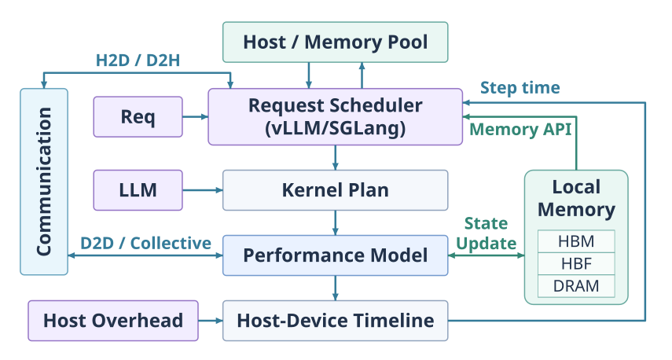

<h1 align="center">Uni<sup>3</sup>Sim: Simulation for LLM Serving at Scale</h1>

<p align="center">
  Xinhao Yang<sup>*</sup>, Yu Zhu<sup>*</sup>, Tianyu Liao<sup>*</sup>, Tongxin Xie, Zhenhua Zhu<sup>†</sup>, Yu Wang<br>
  NICS-EFC, Tsinghua University<br>
  <sup>*</sup> These authors contributed equally.&nbsp;&nbsp; <sup>†</sup> Corresponding author.
</p>

<p align="center">
  <a href="https://thu-nics.github.io/uni3sim-website/">🌐 Project Page</a>
</p>

Uni³Sim predicts LLM inference latency and throughput by combining framework execution models with analytical models of compute, memory, and interconnects. Explore how workloads, parallelism, and hardware choices affect the whole system.

## Features

- **Framework-aware serving.** Model batching, scheduling, and parallel execution through vLLM and SGLang paths.
- **Shared host-device timeline.** Follow compute, memory transfers, and communication together to find bottlenecks.
- **Hardware exploration.** Compare accelerator and memory-system designs using hardware specifications and independent microbenchmarks.



## Quickstart

Prerequisites: Linux, Python 3.10 or later, Git LFS, and a C compiler. The examples below run on the CPU without model weights or a GPU.

```bash
git clone --recurse-submodules https://github.com/thu-nics/uni3sim.git
cd uni3sim
git lfs install --local
git lfs pull

python3 -m venv .venv
source .venv/bin/activate
python -m pip install -r requirements-reports.txt
mkdir -p build
cc -O3 -shared -fPIC -o build/lru_sim.so src/kernel/csrc/lru_sim.c
```

**Predict Kernel performance** and generate an interactive report:

```bash
python scripts/evaluation/kernel/run_kernel_evaluation.py \
  --hardware-id nvidia_a800 --mode forward --interactive-report
```

The command prints the report path. Open the HTML file directly in your browser.

**Explore a Serving timeline** with the synthetic CPU example:

```bash
python scripts/experiments/run_serving_experiments.py \
  --manifest configs/evaluation/experiments/cpu_qwen3_conformance_example.json \
  --run-dir experiment_logs/serving/demo --cpu-run
```

Open `experiment_logs/serving/demo/conformance/result.html`. This synthetic example checks execution and reporting; hardware accuracy is evaluated separately.

## Learn more

- [Serving models and support](docs/serving_system.md)
- [Kernel performance models](docs/kernel_performance_model.md)

Backend support and validation scope are documented in the guides above.

## Citation and Acknowledgements

- **Unified compute modeling.** If you use Uni³Sim's compute models, please cite [our paper](https://doi.org/10.1109/LCA.2026.3752142).

  ```bibtex
  @article{yang2026kernel,
    author = {Yang, Xinhao and Zhu, Yu and Xue, Yukun and Li, Zhaoshi and Li, Xiuhong and Wu, Baodong and Li, Wen and Mao, Qiuli and Li, Boxun and Chen, Xiaoming and Dai, Guohao and Zhu, Zhangming and Yang, Huazhong and Xie, Yuan and Zhu, Zhenhua and Wang, Yu},
    title = {When Kernel Meets System: Chip-to-System Modeling across {AI} Hardware for {LLM} Serving},
    journal = {IEEE Computer Architecture Letters},
    year = {2026},
    pages = {1--4},
    doi = {10.1109/LCA.2026.3752142}
  }
  ```

- **Unified communication modeling.** If you use Uni³Sim's communication models, please cite [our paper](https://arxiv.org/abs/2611.30191) (to appear at HPCA 2027).

  ```bibtex
  @misc{zhu2026makingprotocoleffectsexplicit,
    title = {Making Protocol Effects Explicit: {LLM}-to-Packet Simulation for Superpod Interconnect Exploration},
    author = {Yu Zhu and Xinhao Yang and Zhaoshi Li and Baodong Wu and Boxun Li and Wenxue Li and Guohao Dai and Hongyang Jia and Shuwen Deng and Huazhong Yang and Yuan Xie and Zhenhua Zhu and Yu Wang},
    year = {2026},
    eprint = {2611.30191},
    archivePrefix = {arXiv},
    primaryClass = {cs.AR},
    url = {https://arxiv.org/abs/2611.30191}
  }
  ```

- **Unified memory-system modeling.** Citation pending public release.

### Acknowledgements

Uni³Sim's approach to integrating real-world LLM serving frameworks was inspired by rLLM. We recommend citing [rLLM](https://dl.acm.org/doi/abs/10.1145/3845814.3850087) as well.

```bibtex
@inproceedings{liu2027rllm,
  author = {Liu, Shiyi and Xia, Yiran and Zhu, Zhenhua and Bai, Chen and Xu, Ceyu and Xie, Yuan},
  title = {{rLLM}: A Serving-Aware Simulation Framework for Realistic {LLM} Hardware Evaluation},
  booktitle = {Proceedings of the 32nd ACM International Conference on Architectural Support for Programming Languages and Operating Systems, Volume 1},
  series = {ASPLOS '27},
  publisher = {Association for Computing Machinery},
  year = {2027},
  pages = {790--803},
  doi = {10.1145/3845814.3850087},
  url = {https://doi.org/10.1145/3845814.3850087}
}
```

## Contact

Zhenhua Zhu: [zhuzhenhua@mail.tsinghua.edu.cn](mailto:zhuzhenhua@mail.tsinghua.edu.cn)
