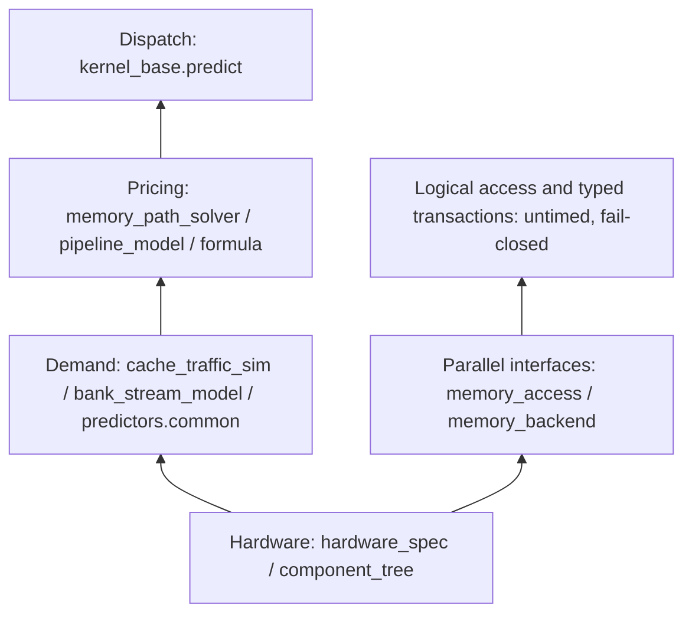

# Uni³Sim Kernel analytical performance model

The Kernel layer predicts the execution time and physical bottleneck of one invocation from operator shape, discrete launch decisions, and target hardware, without fitting target-kernel durations. [Serving design](serving_system.md) explains how requests become invocations. Section 10 describes parameter evidence; section 13 gives the complete solution order.

The governing separation is **work demand versus hardware service**. Operator/layout/launch semantics determine work; specifications and independent mechanism measurements determine service. Target execution times belong only to evaluation.

## 1. White-box analytical modeling

The model explains an execution before pricing it. It identifies arithmetic, traffic, synchronization, resource lower bounds, serial dependencies, valid overlap, and the evidence behind each conclusion. Unknown mechanisms remain limitations. An unexplained error does not authorize a per-shape, per-name, or kernel-class duration correction.

## 2. Inputs, outputs, and ownership

### 2.1 Inputs

A prediction needs operator semantics (kind, shape, dtype, layout, variant, actual lengths/routing), launch semantics (algorithm, tile, grid/block, split, workspace, worker assignment, static occupancy), and hardware semantics (units, clocks, throughput, hierarchy, bandwidth, request capacity, concurrency, launch mechanism). These are distinct contracts: shape cannot guess a tile, a name cannot replace a launch, and peak bandwidth cannot explain unknown request concurrency.

### 2.2 Outputs

Outputs include total duration, resource lower bounds, worker/pipeline makespan, empty/nonempty/launch floors, bottleneck, support level, and unresolved mechanisms. Evaluation may compare intermediate values with profiler observations, but must not duplicate predictor formulas. Serving consumes invocation predictions without feeding request-level observations back into Kernel formulas.

### 2.3 Applicability

The Kernel layer prices one complete call on declared device resources. Unrelated concurrent kernels, multitenancy, cross-request persisting cache, compression, and sparse skipping require explicit workload/hardware contracts. Serving owns inter-kernel dependencies and competition; these must not be hidden in a kernel efficiency.

Uniform cache sets, physical partitions, and worker loads require address, source/launch, or independent observational evidence. Otherwise retain imbalance limitations or explicit partition/worker demand.

### 2.4 Memory layers and parallel interfaces

The analytical pricing path and `memory_access` interface family share the `src/kernel/` owner but serve distinct purposes. `cache_traffic_sim.py` models operator cache traffic, `memory_path_solver.py` solves analytical paths, and HWSpec `kernel_memory_model` declares the hardware mechanism family.

Hardware declares evidenced capacities; traffic derives demands from semantics/addresses/launch; pricing solves service, latency, and dependencies; dispatch selects the predictor. `memory_access.py`, `memory_backend.py`, and `memory_access_builder.py` define logical programs, typed transactions, and backend/session contracts. The historical initial builder supported logical GEMM access only and did not generate physical transactions. Access programs remain untimed and fail closed on missing semantics; interface output does not replace existing pricing/traffic formulas.

KV-cache update prediction prices device writes; Kernel memory paths price data movement; Serving KV-cache management owns capacity, blocks, and request lifetime. Capacity management itself creates no kernel duration.

## 3. From operators to demand

Demand is independent of time. No efficiency inferred from target duration belongs in its construction.

### 3.1 Compute demand

Count semantic operations, compiler lowering, tile padding/tails, worker assignment, and indivisible serial requests by actual Matrix/Tensor/Cube, Vector, Reduction, SFU, and ALU resources. Softmax, for example, may use Vector, Exp, Div, and reduction resources. Detailed typed service needs statically established work; one undifferentiated efficiency is not a substitute.

### 3.2 Memory demand

Distinguish logical tensor bytes, source-issued load/store traffic, and physical bytes/transactions after coalescing, caches, replay, and transaction granularity. A cache path may be `Producer → L1 → L2 → DRAM`; NPU paths may instead use DMA/MTE, SRAM/UB, and GM. Omit nonexistent nodes and expose unknown ones.

Derive traffic from addresses, request granularity, conditional misses, multicast/replay, and unique footprint. Hit rates route requests; they cannot turn logical tensor bytes into physical traffic without accounting for changing transaction sizes.

### 3.3 Synchronization and intermediate state

Barriers, semaphores, reducers, split scratch, workspace, and producer/consumer buffers enter only when source or ABI establishes their dependencies and lifetime. A split count alone does not establish scratch dtype, whether data reaches DRAM, or when a reducer may consume it; launch sequence, pointer dtype, and physical evidence must close those questions separately.

## 4. Compute time

Matrix, Vector, Reduction, and SFU work use distinct pipes, so compute time is solved by resource rather than one summed FLOPS count:

$$
P_k^{\mathrm{eff}}
=N_{\mathrm{active}}P_k^{\mathrm{unit}}
\eta_{k,\mathrm{shape}}
\eta_{k,\mathrm{schedule}}
$$

$$
T_k =
\frac{OP_k}
{P_k^{\mathrm{eff}}}
$$

Here $OP_k$ is typed work, $N_{active}$ the physical units active in the current wave, and $P_k^{unit}$ the per-unit throughput for that operation. Shape efficiency represents padding/alignment/tails; schedule efficiency requires source, static schedule, or independent mechanism evidence. Peak throughput is valid only for the matching operation, dtype, clock, and execution domain.

Resident blocks/warps supply producers and latency hiding; they do not replicate a physical compute pipe. Low occupancy is not automatically a linear compute-efficiency penalty. With an evidenced per-worker service sequence, sum serial services within each worker and take the slowest worker:

$$
T_{\mathrm{typed}}
=\max_w\sum_s
\left(
\frac{OP_{s,w}}{P_s^{\mathrm{unit}}}
+N_{s,w}\tau_s
\right)
$$

$OP_{s,w}$ is worker-local work, $N_{s,w}$ indivisible requests, and $\tau_s$ independently measured service time. Without worker mapping, retain the aggregate lower bound rather than inventing a critical worker or instruction count.

If independent mechanisms establish an exact request-size service function $L_s(q)$, use source/launch-derived request sets $Q_w$:

$$
T_{exact}=\max_w\sum_{q\in Q_w}L_s(q)
$$

This is not a target-duration lookup by kernel name.

Known thread/register/on-chip allocations constrain per-unit resident tasks:

$$
B_{res}
=\min\left(
B_{arch},
\left\lfloor\frac{T_{cap}}{T_{task}}\right\rfloor,
\left\lfloor\frac{R_{cap}}{R_{task}}\right\rfloor,
\left\lfloor\frac{S_{cap}}{S_{task}}\right\rfloor
\right)
$$

GPU active warps/waves and independently generated memory requests are then:

$$
W_{active}
=\min(W_{arch},B_{res}W_{task}),\qquad
Q_{workload}=W_{active}q_{warp}
$$

These constrain producer count and MLP. Physical compute units remain $N_{active}$. In the aggregate path, homogeneous tasks occupying one unit service stream may use a tail-wave correction:

$$
n_{wave}=\left\lceil\frac{N_{task}}{N_{unit}}\right\rceil,
\qquad
\eta_{tail}=\frac{N_{task}}{n_{wave}N_{unit}}
$$

Do not multiply $N_{unit}$ by residency, and do not charge tail efficiency again when an explicit worker makespan already includes the tail.

## 5. Memory time

Bytes/bandwidth alone omits small-request latency, finite concurrency, cache-resident behavior, and transaction-rate limits.

### 5.1 Logical bytes and physical transactions

For equal-granularity lower-level transactions on each miss:

$$
N_{L1}=N_0,\qquad
N_{L2}=m_1N_0,\qquad
N_{DRAM}=m_1m_2N_0
$$

$$
D_i=N_iB_i
$$

$N_0$ is the initial physical request count. $m_1$ is conditional L1 miss rate and $m_2$ conditional L2 miss rate; $N_i$, $B_i$, and $D_i$ are transaction count, size, and bytes. If coalescing, splitting, multicast, or replay changes granularity, count each level from address mapping. DMA/MTE/TMA paths may bypass caches; solve the actual nodes rather than inserting a cache hierarchy.

### 5.2 Path latency and request lifetime

Low-load pointer chasing or equivalent mechanisms measure complete path latency:

$$
L_{L1}^{0,\mathrm{test}},\quad
L_{L2}^{0,\mathrm{test}},\quad
L_{DRAM}^{0,\mathrm{test}}
$$

Only matched producer, instruction, transaction size, address mapping, and return paths permit adjacent-path differencing:

$$
\Delta t_{L1}^{0}=L_{L1}^{0,\mathrm{test}}
$$

$$
\Delta t_{L2}^{0}
\approx L_{L2}^{0,\mathrm{test}}-L_{L1}^{0,\mathrm{test}},\qquad
\Delta t_{DRAM}^{0}
\approx L_{DRAM}^{0,\mathrm{test}}-L_{L2}^{0,\mathrm{test}}
$$

Under load, each incremental response includes queueing:

$$
\Delta t_i=\Delta t_i^0+t_{q,i}
$$

An initial request occupies a source scoreboard/load-queue/equivalent slot for:

$$
\boxed{
t_{req}
=\Delta t_{L1}
+m_1\Delta t_{L2}
+m_1m_2\Delta t_{DRAM}
}
$$

Every request pays L1, only L1 misses pay L2, and only L2 misses continue to DRAM. This full source lifetime differs from each local queue-entry lifetime.

### 5.3 Bytes/s and requests/s

Define routing fraction and arrival rate relative to initial requests:

$$
\gamma_i=\frac{N_i}{N_0},\qquad
\lambda_i=\gamma_i\lambda_0
$$

A level with sustained byte capacity and an independently established request-rate ceiling has transaction capacity:

$$
\lambda_i^{\mathrm{cap}}
=\min\left(
\frac{BW_i^{\mathrm{sust}}}{B_i},
\Lambda_i^{\mathrm{req,max}}
\right)
$$

Its directly checkable lower bound is:

$$
\boxed{
T_i^{\mathrm{cap}}
=\max\left(
\frac{D_i}{BW_i^{\mathrm{sust}}},
\frac{N_i}{\Lambda_i^{\mathrm{req,max}}}
\right)
=\frac{N_i}{\lambda_i^{\mathrm{cap}}}
}
$$

An unknown request ceiling stays absent; peak bandwidth and an assumed line size do not establish it. Do not double-charge a request-rate restriction already included in sustained bandwidth for that pattern.

With uniform use of $N_{part,i}$ physical partitions, equivalent per-partition service time is:

$$
s_i
=\frac{N_{part,i}}{\lambda_i^{cap}}
=\max\left(
\frac{B_i}{BW_i^{part,sust}},
\frac{1}{\Lambda_i^{part,req,max}}
\right)
$$

This is server occupation per transaction, not end-to-end path latency. Nonuniform requests require actual per-partition arrival rates rather than the uniform average.

### 5.4 Source slots, local queues, and bandwidth-delay product

Independent workload requests and hardware source-slot capacity jointly determine in-flight concurrency:

$$
Q_{workload}=N_{producer}^{active}q_{producer},\qquad
Q_{src}=\min(Q_{workload},Q_{src}^{hardware})
$$

Little's law gives the chip-wide initial-request rate sustainable by source slots:

$$
\lambda_{src}(\lambda_0)
=\frac{N_{active}Q_{src}}{t_{req}(\lambda_0)}
$$

L1 MSHRs, L2 miss queues, DMA descriptors, and DRAM credits are distinct structures, not aliases for source slots. For each identifiable local structure, specify its allocation fraction, entry lifetime, and capacity:

$$
Q_j^{used}=\gamma_j^Q\lambda_0\ell_j^Q,\qquad
\lambda_{Q,j}(\lambda_0)
=\frac{Q_j^{max}}{\gamma_j^Q\ell_j^Q(\lambda_0)}
$$

An L1 miss entry is allocated only on L1 misses and generally spans downstream response. Do not charge all initial requests or count one physical entry as two queues.

An independently established issue frontend may impose:

$$
\lambda_{frontend}
=N_{active}r_{frontend}^{unit}
$$

Per-unit frontend rate depends on instruction mix and transactions/instruction. Without independent evidence it stays absent; achieved bandwidth cannot determine it.

At zero queueing, source lifetime is:

$$
t_{req}^{0}
=\Delta t_{L1}^{0}
+m_1\Delta t_{L2}^{0}
+m_1m_2\Delta t_{DRAM}^{0}
$$

Source slots and local entries needed to saturate level $i$ are respectively:

$$
\boxed{
Q_{need,i}^{src,total}
=\frac{\lambda_i^{cap}}{\gamma_i}t_{req}^{0},
\qquad
Q_{need,j\leftarrow i}^{level}
=\gamma_j^Q
\frac{\lambda_i^{cap}}{\gamma_i}
\ell_j^{Q,0}
}
$$

This bandwidth-delay-product check distinguishes global source scope from local queue scope. A high byte capacity remains unreachable if producers, MSHRs, descriptors, or credits are insufficient.

### 5.5 Self-consistent completion rate

Convert service capacities into the initial-request domain:

$$
\lambda_0^{cap}
=\min_{i:\gamma_i>0}
\frac{\lambda_i^{cap}}{\gamma_i}
$$

Combine frontend, source, and independently identified local constraints:

$$
\phi(\lambda)
=\min\left[
\lambda_{frontend},
\lambda_{src}(\lambda),
\min_j\lambda_{Q,j}(\lambda)
\right]
$$

Evaluate their zero-queue capacity bound:

$$
\phi^0
=\min\left[
\lambda_{frontend},
\frac{N_{active}Q_{src}}{t_{req}^0},
\min_j
\frac{Q_j^{max}}{\gamma_j^Q\ell_j^{Q,0}}
\right]
$$

Omit any frontend/local term lacking independent evidence; an unknown constraint cannot create a finite cap.

Only hardware explicitly declaring an M/D/1 capability uses the following queue model, with $\rho_i=\lambda_i/\lambda_i^{cap}$:

$$
t_{q,i}
=\frac{\rho_i}{2(1-\rho_i)}s_i,
\qquad 0\le\rho_i<1
$$

This analytical model has explicit applicability assumptions. It is not a fitted curve. If finite structures can cover the capacity point, use capacity exactly; otherwise solve the physical fixed point below capacity:

$$
\boxed{
\lambda_0^*
=
\begin{cases}
\lambda_0^{cap},
&\phi^0\ge\lambda_0^{cap},\\[4pt]
\text{physical solution of }\lambda=\phi(\lambda)
,
&\phi^0<\lambda_0^{cap}.
\end{cases}
}
$$

Rate determines utilization and queue wait; waits extend source/local lifetimes, reducing the sustainable rate. Without a queue capability, queue wait remains unknown and only established service/source/credit constraints apply. Do not insert generic M/D/1, a fixed $\rho=0.99$, or arbitrary clipping.

Steady memory time is:

$$
T_{memory}^{steady}=\frac{N_0}{\lambda_0^*}
$$

Without provable source/queue limits, retain byte/request capacity and expose the evidence gap.

### 5.6 First request and short work

A short tile cannot assume startup latency is amortized. For first-request latency $L_{first}$ and subsequent steady drainage:

$$
T_{memory}^{tile}
=L_{first}+\frac{\max(N_{stage}-1,0)}{\lambda_0^*}
$$

First-request latency requires a low-load mechanism with the same producer/instruction/target level. It cannot be a short-kernel residual, and cannot be charged again in pipeline or launch floors.

### 5.7 Access-pattern-specific service

Indirect gathers, dependency chains, and fixed transaction shapes may differ despite identical bytes. An isolated mechanism may establish a typed service for part of ingress:

$$
T_{access,s}=\sum_i\frac{D_{logical,i}}{C_{s,i}}
$$

Each $C_{s,i}$ binds access type, dtype, transaction/tile signature, scope, and evidence. It cannot bind kernel names, extrapolate across unknown signatures, or choose a nearest measured capacity. Charge each traffic contribution once; typed service does not automatically alter physical bytes, arbitration, or worker pipelines. Otherwise retain generic lower bounds and limitations.

### 5.8 Byte-only reduction

Where only aggregate bytes are established, define $D_0$ as source bytes and $\gamma_i^B=D_i/D_0$:

$$
\lambda_0^{B,cap}
=\min_i\frac{BW_i^{sust}}{\gamma_i^B},\qquad
T_{memory}=\frac{D_0}{\lambda_0^{B,cap}}
$$

This yields an aggregate bandwidth lower bound, without request ceilings, slots, queues, or first-request latency. Independently evidenced absolute-byte worker stages/dependencies may still form a pipeline. Do not reverse-engineer requests, lifetimes, or queues from bytes, or fill gaps with a default transaction size. Mark the result aggregate-only.

### 5.9 Shared read/write resources

If read/write share a half-duplex DRAM/NoC resource, taking the maximum of separately timed paths is invalid. A direction-order-independent lower bound is:

$$
\boxed{
T_{shared}^{lb}=\frac{D_R}{C_R}+\frac{D_W}{C_W}
}
$$

With one capacity $C$, this becomes $(D_R+D_W)/C$. A same-card copy of $B$ bytes generates both a source read and destination write, costing $B/C_R+B/C_W$.

Only source/launch evidence of controller-visible global direction epochs $\mathcal E$ permits turn costs:

$$
T_{shared}
=\sum_{e\in\mathcal E}
\left(
\frac{D_{R,e}}{C_R}
+\frac{D_{W,e}}{C_W}
+I_{RW}(e)\tau_{RW}
+I_{WR}(e)\tau_{WR}
\right)
$$

A kernel's read/write ratio does not establish epoch order, and mixed-bandwidth reduction does not determine per-turn constants. Without ordering evidence, publish only the service-sum lower bound.

## 6. Workers, dependencies, and pipelines

A pipeline requires task-to-worker mapping, stages and dependencies, physical resources, buffer counts/reuse, shared-resource arbitration, and any persistent-queue assignment. For independent Load–Compute–Store resources with sufficient buffers:

$$
II=\max(T_{load},T_{compute},T_{store})
$$

A worker processing $n_w$ tasks has:

$$
M_w=T_{fill}+(n_w-1)II+T_{drain}
$$

$$
T_{execution}=\max_w M_w
$$

FlashAttention shares Matrix service between QK/PV and has asymmetric K/V buffers. MoE routing creates expert/worker imbalance. Overlap requires closed dependency, buffer, and worker semantics; otherwise retain aggregate lower bounds.

Within one attention tile, `QK → online softmax/update → PV` is serial:

$$
L_{compute,tile}=T_{QK}+T_{softmax}+T_{PV}
$$

Across tiles, independent Vector/SFU and load/store resources may overlap shared Matrix work if buffers/barriers permit:

$$
II_{FA}
=\max\left(
T_{load},
T_{QK}+T_{PV},
T_{softmax},
T_{store}
\right)
$$

Dependencies and occupancy of the same physical resource require addition; only valid cross-tile resource independence permits maxima. Choose `add`/`max` from the execution DAG, never from lower evaluation error.

Double buffering additionally requires:

$$
\boxed{
C_{buffer}\ge n_{buf}S_{tile}
}
$$

$C_{buffer}$ is the SRAM/SMEM/UB capacity actually available to the pipeline; $n_{buf}$ buffers each hold $S_{tile}$. Insufficient capacity, overlapping lifetimes, or barriers prevent ideal load/compute overlap. Explicit tail/critical-worker accounting excludes additional tail-efficiency or empirical pipeline-floor charges.

## 7. Launch and short kernels

Complete invocation time combines resource execution with task floors:

$$
T_{kernel}=\max\left(
T_{empty},
T_{nonempty,min},
t_{dispatch}+T_{execution}
\right)
$$

$T_{empty}$ is a complete empty submission/scheduling task; $T_{nonempty,min}$ is a minimum nonempty mechanism floor. Dispatch is additive only if independently identifiable from full task duration. Execution includes compute, memory, synchronization, and fill/drain.

A measured complete empty/nonempty task duration is a max floor, not an additional execution charge. Host elapsed, device events, profiler replay, and kernel events are different timing domains. Launch mechanisms must match grid/block/task/runtime and timer domain, and come from mechanisms independent of production workloads. Operator-specific empirical constants are invalid.

## 8. Operator instantiations

### 8.1 GEMM

For $[B,M,K]\times[B,K,N]$:

$$
OP_{GEMM}=2BMNK
$$

Actual issued work additionally includes launch-tile padding in M/N/K, split work, and reduction. Minimum logical traffic is:

$$
D_{logical}=(BMK+BKN+BMN)d
$$

$d$ is element width. Cache reuse, swizzle, and rereads determine physical traffic. For $S>1$ K splits with an ABI-proven reducer, $E=BMN$ outputs and partial width $d_p$ imply at least $SEd_p$ main writes, matching reducer reads, and $Ed$ final writes. Whether partials reach DRAM, remain in L2, or use an on-chip protocol needs cache/ABI/traffic evidence. Large GEMMs commonly expose Matrix/DRAM limits; small ones expose launch, tails, and insufficient concurrency.

### 8.2 FlashAttention

For request lengths $L_{Q,b},L_{KV,b}$, query heads $H_Q$, and head dimension $d$, the unmasked rectangular approximation is:

$$
OP_{FA}
\approx 4H_Qd\sum_b L_{Q,b}L_{KV,b}
$$

The factor four counts QK and PV multiply-adds. Actual causal/prefix work sums each query's visible keys. For bottom-right causal attention with the queries as a KV suffix:

$$
V_q
=\min\left(
L_{KV},
L_{KV}-L_Q+q+1
\right)
$$

Clamp negative values to zero. Work scales with $\sum_q V_q$, not a universal full rectangle. Decode's minimum logical K/V reads are:

$$
D_{KV}=2\sum_b L_{KV,b}H_{KV}d\,d_t
$$

$d_t$ is element width; the factor two counts K and V. Paged, varlen, chunked-prefill, and MLA paths need actual lengths, page tables, head representations, and tile counts rather than only maximum length.

For main+combine split-KV, $E_Q=H_Q\sum_bL_{Q,b}$, $S$ splits, and value width $d_v$ require FP32 partial-value/LSE scratch:

$$
D_{scratch}=E_QS(d_v+1)\times4
$$

Main writes and combine reads the same scratch. Its allocation alone does not prove DRAM traffic. Buffer lifetime, shared Matrix/Vector resources, and worker/split mapping determine valid overlap.

### 8.3 Fused-MoE

With $T$ input tokens and top-k $K_{top}$:

$$
R=T K_{top}=\sum_e T_e
$$

Expert $e$ receives $T_e$ rows. One $[T_e,H]\times[H,I]$ projection contributes:

$$
OP_{MoE}=\sum_e 2T_eHI
$$

Count gates, up/down projections, and activations according to actual structure. Demand depends on routed rows, expert ownership, top-k, tile padding, and rank-local assignment. Weight streaming and activation gather/scatter can have different limiting mechanisms. Mean tokens/expert cannot replace $\{T_e\}$ because padded tiles and imbalance affect makespan. Unknown routing requires an explicit reproducible workload assumption or replay, not a distribution inferred from duration.

### 8.4 Vector

Normalization, RoPE, activation, elementwise, and KV-cache operations have distinct dataflows. Elementwise add/mul over $E$ elements needs at least $3Ed$ tensor traffic but different typed arithmetic. Normalization includes reduction and possible rereads. RoPE needs Q/K, positions, and declared cache paths. KV-cache updates move K/V for actual slots and read mapping; batch and layout are workload inputs. A universal elements-times-constant shortcut cannot hide these differences.

## 9. Cross-hardware consistency

All architectures share the decomposition `demand → capacities → dependencies/concurrency → launch composition → duration/diagnostics`, without requiring identical resource topology.

| Concern | GPU cache path | GPU async-copy path | NPU DMA/SRAM path |
|---|---|---|---|
| Worker | CTA/warp on SM/CU | CTA/warp on SM/CU | AI Core task |
| Compute | Tensor/Matrix, Vector, SFU | Tensor/Matrix, Vector, SFU | Cube/MXU, Vector, Scalar |
| Data path | L1→L2→HBM | HBM→NoC→TMA/DMA→SMEM | GM/HBM→NoC→DMA/MTE→SRAM/UB |
| Producer | Resident warp/wave | Copy stage/descriptor | CopyIn/CopyOut or tile queue |
| Finite structures | Scoreboard, MSHR, miss queue, DRAM credit | Descriptors, copy queue, NoC/DRAM credit | MTE/DMA queue, NoC/GM credit |
| On-chip constraints | Registers, L1/SMEM, banks | SMEM buffers, banks, barriers | SRAM/UB buffers, banks, events |
| Overlap | Warp latency hiding | Async copy/double buffering | CopyIn/Compute/CopyOut |

These are conceptual mappings, not claims of implemented evidence for every node. Omit absent L1, use byte-only paths without transactions, and serialize when async/buffering evidence is missing. Classical Roofline is the reduced case with one compute resource, one memory capacity, no transaction/queue evidence, and resource lower bounds only.

A800, C500, 910B, and H200 may have different evidence maturity and support levels under the same interface. Hardware capabilities/evidence express those differences; public formulas must not fork into unrelated hardware-ID-specific predictors.

## 10. Parameters and evidence

Allowed sources are architectural/specification facts; compiler/operator source and static lowering; independent mechanism microbenchmarks; and non-duration observations of launch or resource behavior. Their maturity must be explicit:

| Level | Meaning | Production use |
|---|---|---|
| Official/static | Specification, architecture, ISA, compiler/operator semantics | Capacity, work, discrete launch |
| Measured mechanism | Independent reproducible mechanism measurement | Scoped physical parameters with units |
| Observation | Launch or non-duration profiler evidence | Validate/complete launch and demand |
| Candidate | Plausible physics but incomplete provenance/mapping/domain | Retain as candidate, without complete-support claims |
| Unsupported | No lawful evidence or undefined composition | Missing parameter, limitation, or explicit failure |

Evidence maturity is independent of prediction accuracy. Lower MAPE cannot legitimize an unsupported parameter; failure to improve MAPE cannot invalidate an independently established mechanism.

| Independent experiment | Controls | Evidence |
|---|---|---|
| Long Matrix/Vector/SFU loop | Typed operation, dependency, dtype, active units | Per-unit throughput, fixed typed service, structural efficiency |
| Low-load pointer chasing | Footprint, stride, target hit level | Path latency; adjacent differences only under matched semantics |
| Hierarchical streaming | Cache residency, direction, adequate MLP | Sustained byte capacity |
| Transaction-rate sweep | Size, access type, adequate MLP | Request ceiling versus byte ceiling |
| Frontend issue sweep | Independent loads/stores, transactions/instruction | $r_{frontend}^{unit}$ |
| MLP/credit sweep | Producers, independent chains, target level | Scoped source/local capacity |
| Latency-load sweep | Offered load, producers | Validate analytical queue assumptions |
| SRAM/SMEM/UB sweep | Stride, banks, width, buffers | Capacity, bank service, overlap |
| DMA/TMA/MTE sweep | Tile, in-flight depth | Setup, bandwidth, descriptors/credits, overlap |
| Empty/minimal task | Grid, block/task, timing domain | Complete empty/nonempty floors |

One ambiguous knee cannot independently establish source slots, MSHRs, and DRAM credits. Publish one correctly scoped effective constraint if those mechanisms cannot be distinguished.

Each empirical production parameter needs a canonical name, physical meaning, units, hardware/software/clock domain, dtype/variant/shape domain, evidence type, reproducible provenance, samples/aggregation, consumer/composition, and absent/out-of-domain behavior. Discrete measurements without a physical scaling law require exact lookup, without interpolation/extrapolation.

Target production operator/kernel/Serving durations cannot train, regress, interpolate, select thresholds, or correct residuals. Holdout/cross-validation or calling the process calibration does not alter that rule. Reproducing a complete production operator and storing its duration as a mechanism parameter is still fitting. Hardware configs, launch manifests, and mechanism reports own numeric constants and raw identities; this design guide does not duplicate changing binary hashes or experiment snapshots.

## 11. Diagnostics and support levels

Expose typed work/time, traffic and memory constraints, worker critical paths, launch composition, and all missing parameters/lower-bound limitations.

| Contract level | Meaning |
|---|---|
| `complete` | All required semantics closed; no limitation |
| `partial` | Some detailed source/launch-backed mechanisms, with explicit remaining limitations |
| `aggregate_only` | Reliable aggregate demand/lower bounds, without invented transaction/worker/pipeline semantics |
| `compatibility` | Explicit simplification for compatible hardware/legacy abstraction, with limitations |

`unsupported` is not a fifth returned level: missing necessary launch/shape/hardware semantics must raise at the boundary. `launch_selector_unavailable` remains launchless. `typed_service_unavailable` may retain verified launch only in explicitly approved source domains while pricing remains rejected; currently this is H200 ordinary 0.11 greedy argmax, whose geometry, hardware inputs, shared storage, and scratch must all be rechecked by the same source selector. Renaming a status or retaining metadata cannot create full prediction support. No silent old-formula/default-hardware fallback is allowed.

## 12. Validation

Validate in order: shape/launch/worker identity, operations/bytes/transaction conservation, resource demand versus non-duration observations, source dependencies/buffers/pipeline, then final duration/bottleneck against independent observations.

| Output | Independent observation | Question |
|---|---|---|
| $N_i,D_i,\gamma_i$ | Transactions/sectors, physical bytes, conditional hits | Addressing, granularity, routing |
| $L_i^{0,test},\Delta t_i^0$ | Matching low-load path latency | Valid differencing |
| $\lambda_i^{cap},\rho_i$ | Achieved bytes/s and requests/s | Service capacity and bottleneck |
| $Q_{src},Q_j^{used},\lambda_0^*$ | In-flight/queue counters and completion rate | Correct concurrency scope |
| $OP_k,P_k^{eff}$ | Typed work/instructions, pipe duty, throughput | Lowering and resource mapping |
| Stages, $II$, makespan | Timelines, barriers, copy intervals | Dependencies, buffers, overlap |
| Duration/bottleneck | Device time isolated from Forward | Final accuracy/classification |

Per-sample relative duration error is:

$$
e_T
=\frac{|\widehat T-T^{measured}|}{T^{measured}}
$$

Report median, P90, maximum, bottleneck classification, shape/launch coverage, and limitations. Mean MAPE alone hides tails and compensating intermediate errors.

Useful ablations compare logical versus physical traffic, hierarchical versus DRAM-only paths, byte-only versus byte+request capacity, infinite versus finite source/local slots, absent versus evidenced queues, serial versus dependency pipelines, and aggregate versus explicit worker schedules. They explain changes in intermediate quantities and predictions; evaluation error must not choose production formulas, thresholds, parameters, or adoption of an independently established mechanism.

Missing evidence calls for limitations, independent mechanisms, or explicit unsupported combinations. Reproducible physics establishes model credibility.

## 13. Solution order for one prediction

1. Parse shape, actual runtime lengths, dtype/layout, and semantic work.
2. Freeze variant, tile, grid/block, split, workers, workspace, and occupancy from launch.
3. Derive typed compute and logical/source-issued/physical traffic.
4. Select evidenced memory paths and derive $N_i,D_i,\gamma_i$ and byte/request capacities.
5. Derive workload request concurrency from occupancy/dependencies, then combine with source-slot capacity.
6. Solve request/local lifetimes and completion rate where transaction/latency/finite structures close; otherwise declare byte-only reduction.
7. Solve compute/memory/synchronization service and short-work/first-request bounds.
8. Compose workers, stages, buffers, and dependencies into critical-worker makespan.
9. Combine matching-domain empty/nonempty floors and independently identifiable dispatch.
10. Return duration, resources, bottleneck, support level, evidence, and limitations.

Each missing mechanism must remain visible. No stage may replace missing semantics with a value inferred from target duration.

## 14. Extension boundaries

New operators must connect operator semantics, discrete launch, demand, and unified results, validating conservation, launch completeness, diagnostics, and duration. Serving consumes this same chain rather than maintaining separate formulas.

New hardware contributes evidenced capabilities, mechanism parameters, and an interface-compatible launch selector. Missing support remains explicit. New Schedulers/frameworks determine requests and logical operators; they cannot select empirical Kernel durations. Extensions broaden the shared physical model's semantic/evidence coverage rather than accumulating incompatible per-scenario predictors.
